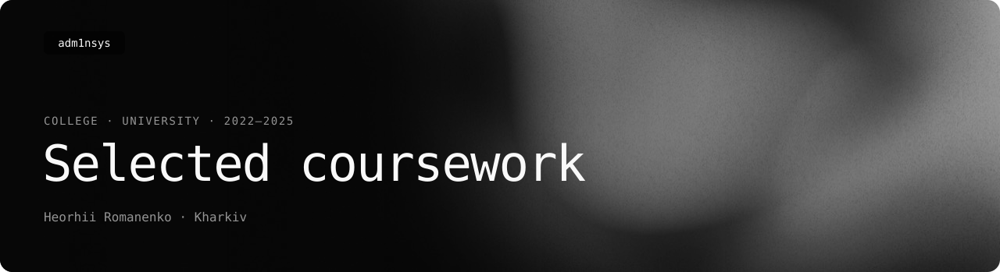

<picture>
  <source media="(prefers-color-scheme: light)" srcset=".github/readme/banner-light.svg">
  
</picture>

  
  
  
  

A curated selection of my coursework from college and university in Kharkiv, 2022–2025: computer networks in Cisco Packet Tracer, a diploma web app, two semesters of AutoCAD drawings, a magazine layout and design work.

This is **not every lab** — only the ones worth showing. Works are kept as they were submitted; the only changes are fixes that keep them running here (relative paths, removed junk files). The browsable version with previews is on the **[site](https://adm1nsys.github.io/education/)** — in German, with an English switch.

## College

Kharkiv Professional College of Information Technologies, National Aerospace University “Kharkiv Aviation Institute”.
Specialty 172 Telecommunications and Radio Engineering, groups МЗ-21 → МЗ-31. Selected works 2022 – 2024.

| | Work | What it is | Tools |
|---|---|---|---|
| ⭐ | [**Micromouse maze editor**](college/2024-diploma-micromouse) · Jun 2024 | **Diploma project.** Generates 16×16 mazes for Micromouse robot competitions from prepared 4×4 sectors, lets you draw one by hand, exports and imports JSON. | JS, jQuery, JSON |
| | [**Computer networks**](college/computer-networks) · 2022 – 2023 | TCP/IP, office LAN, wireless networks and a company network project in Packet Tracer; plus a [network security lab](college/network-security). | Cisco Packet Tracer |
| | [**NumeraLogic**](college/2023-numeralogic) · Oct – Dec 2023 | Coursework: Android calculator built in MIT App Inventor ([source](college/2023-numeralogic/app-inventor), [explanatory note](college/2023-numeralogic/docs/explanatory-note.pdf)) and its download site. [Demo video](college/2023-numeralogic/media/demo.mp4). | App Inventor, HTML/CSS |
| | [Web programming course](college/web-programming) · Sep 2023 – Apr 2024 | A year of classwork: tables, layouts, PHP form, calculators, 15-puzzle, jQuery, Vue, multi-language page. | HTML, CSS, JS, PHP |
| | [First JavaScript calculator](college/2023-calculator) · May 2023 | Where it started. | JS, CSS |

## University

Kharkiv National University of Radio Electronics, publishing and printing, group ВПВПС-23-2. Selected works 2023 – 2025.

| | Work | What it is | Tools |
|---|---|---|---|
| ⭐ | [**Engineering graphics**](university/engineering-graphics) · Sep 2023 – Jun 2024 | Two semesters of technical drawing: projections, sections, 3D models, tests and exam — every sheet as PDF and DWG. [Certificate of participation](university/engineering-graphics/certificate-hhn-daad.pdf) — Heilbronn University of Applied Sciences, DAAD. | AutoCAD |
| | [Technical mechanics](university/technical-mechanics) · Apr 2025 | Mechanical drawing with explanatory note. | AutoCAD |
| ⭐ | [**Smart Home Living**](university/magazine-smart-home-living) · Dec 2024 | **Coursework.** A magazine about smart lighting: sketches → four concepts → final layout on a modular grid. [PDF](university/magazine-smart-home-living/smart-home-living.pdf) | Illustrator, Figma |
| | [Modular grid calculator](university/grid-calculator) · Nov 2024 | The tool I wrote to calculate the magazine's grid. | JS |
| | [Spot colors & embossing](university/print-finishing) · Dec 2024 | Prepress for three spot colors and embossing, art prize poster. | Illustrator |
| | [Color science](university/color-science) · Mar – May 2025 | Hermann grid in RGB/CMYK, color wheel, swatches. | Illustrator |
| | [Posters & infographics](university/posters) · Dec 2024 | Kharkiv metro infographics, Kyiv poster. | Illustrator |
| | [Web design in Figma](university/web-design-figma) · Oct – Dec 2024 | Multi-page site, 400/404 pages, poster. | Figma |
| | [Department logo](university/logo-mst) · Nov 2024 | Logo for Media Systems and Technologies. | Illustrator |
| | [Social media ads](university/advertising) · Sep 2024 | Posts and stories. | Figma |
| | [Sticker pack](university/sticker-pack) · Mar 2024 | Sticker series with poster, QR code and download page. | Illustrator, Figma |
| | [Patterns](university/patterns) · Sep 2024 | Ornament studies. | Illustrator |

Gallery pages are generated by [`tools/build_galleries.py`](tools/build_galleries.py), the main page sections by [`tools/build_index_sections.py`](tools/build_index_sections.py).

## History

This repository replaces nine older standalone repositories. Each was merged in with its full commit history, so `git log -- <folder>` shows how a work evolved; commits for material added later carry the date the work was made. Some of the earliest labs were later left out of the current version — their history is still in the log.

| Old repository | Now |
|---|---|
| `labs` | [college/web-programming](college/web-programming) |
| `NumeraLogic` | [college/2023-numeralogic](college/2023-numeralogic) |
| `calculator` | [college/2023-calculator](college/2023-calculator) |
| `sticker-pack` | [university/sticker-pack](university/sticker-pack) |
| `grid-calculator` | [university/grid-calculator](university/grid-calculator) |
| `lab`, `list`, `form`, `summary` | earliest labs — in the history only |

## License

My works — drawings, layouts, reports and code — are under [CC BY 4.0](LICENSE): share and adapt them with credit to Heorhii Romanenko. Not covered: the [certificate of participation](university/engineering-graphics/certificate-hhn-daad.pdf), a document issued by Heilbronn University, and third-party libraries in the course projects (jQuery, Vue and others), which keep their own licenses.
