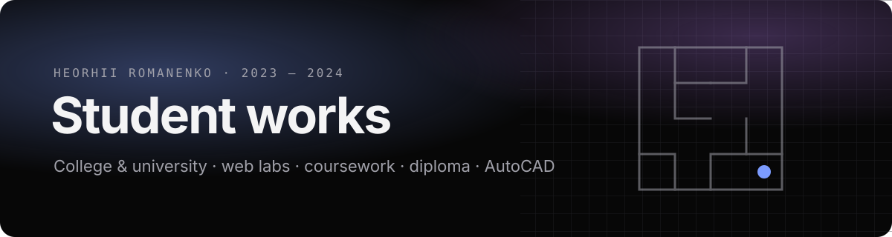

<picture>
  <source media="(prefers-color-scheme: light)" srcset="assets/readme/banner-light.svg">
  
</picture>

  

Everything I built while studying in Kharkiv, collected in one place: first HTML labs, a year of web-programming classwork, an Android coursework, the diploma project, a printed magazine, AutoCAD drawings, color and type labs.

The works are shown as they were made. The only changes are fixes that keep them running in this new location (relative paths, removed `.DS_Store` files). The browsable version with previews is on the **[site](https://adm1nsys.github.io/student-works/)**.

## College · 2022 – 2024

Kharkiv Professional College of Information Technologies, National Aerospace University “Kharkiv Aviation Institute”.
Specialty 172 Telecommunications and Radio Engineering, groups MZ-21 → MZ-31.

| | Work | What it is | Stack |
|---|---|---|---|
| ⭐ | [**Micromouse maze editor**](college/2024-diploma-micromouse) · Jun 2024 | **Diploma project.** Generates 16×16 mazes for Micromouse robot competitions from prepared 4×4 sectors, lets you draw one by hand, exports and imports JSON. | JS, jQuery, JSON |
| | [**NumeraLogic**](college/2023-numeralogic) · Nov – Dec 2023 | Coursework: Android calculator built in MIT App Inventor ([source](college/2023-numeralogic/app-inventor)) and its download site. [Demo video](college/2023-numeralogic/media/demo.mp4). | Android, JS |
| | [**Web programming course**](college/web-programming) · Sep 2023 – Apr 2024 | A year of classwork: tables, layouts, PHP form, calculators, 15-puzzle, jQuery, Vue, multi-language page. | HTML, CSS, JS, jQuery, Vue, PHP |
| | [Cisco Packet Tracer lab](college/2023-networking) · Oct 2023 | A network topology with routers and switches. | Packet Tracer |
| | [About me](college/2023-about-me) · 2023 | The “about yourself” assignment, turned into a hub for my side projects. | HTML, CSS, JS |
| | [Calculator](college/2023-calculator) · May 2023 | First JavaScript calculator. | JS, CSS |
| | [Form](college/2023-form) · Apr 2023 | HTML forms. | HTML, CSS |
| | [List](college/2023-list) · Mar 2023 | Lists and navigation between the first labs. | HTML, CSS |
| | [Title page](college/2023-lab-title) · Feb 2023 | The very first lab: a title page for lab reports. | HTML, CSS |

## University · 2023 – 2025

Kharkiv National University of Radio Electronics, publishing and printing, group VPVPS-23-2.

| | Work | What it is | Tools |
|---|---|---|---|
| ⭐ | [**Smart Home Living**](university/magazine-smart-home-living) · Dec 2024 | **Coursework.** A 21-page magazine about smart lighting: sketches → four concepts → final layout on a modular grid. [PDF](university/magazine-smart-home-living/smart-home-living.pdf) | Illustrator, Figma |
| | [**Modular grid calculator**](university/grid-calculator) · Nov 2024 | The tool I wrote to calculate the magazine's grid. | JS |
| | [Technical mechanics](university/technical-mechanics) · Apr 2025 | Mechanical drawing with explanatory note. | AutoCAD |
| | [Color science](university/color-science) · Mar – May 2025 | Hermann grid in RGB/CMYK, color wheel, swatches. | Illustrator |
| | [Raster imaging](university/raster-imaging) · Mar 2025 | Halftone and screen-ruling scans. | Scanner |
| | [Spot colors & embossing](university/print-finishing) · Dec 2024 | Prepress for three spot colors and embossing, art prize poster. | Illustrator |
| | [Posters & infographics](university/posters) · Dec 2024 | Kharkiv metro infographics, Kyiv poster. | Illustrator |
| | [Web design in Figma](university/web-design-figma) · Oct – Dec 2024 | Multi-page site, 400/404 pages, poster. | Figma |
| | [Department logo](university/logo-mst) · Nov 2024 | Logo for Media Systems and Technologies. | Illustrator |
| | [Modified Courier New](university/type-design) · Sep 2024 | First type-design lab. | FontLab |
| | [Social media ads](university/advertising) · Sep 2024 | Posts and stories. | Figma |
| | [Patterns](university/patterns) · Sep 2024 | Ornament studies. | Illustrator |
| | [Sticker pack](university/sticker-pack) · Mar 2024 | Sticker series with poster, QR code and download page. | Illustrator, Figma |
| | [**Engineering graphics**](university/engineering-graphics) · Oct – Dec 2023 | Assignments, labs and exam — every sheet as PDF and DWG. | AutoCAD |

Gallery pages for the design works are generated by [`tools/build_galleries.py`](tools/build_galleries.py).

## History

This repository replaces nine older standalone repositories. Each one was merged in with its full commit history, so `git log -- <folder>` shows how the work evolved. In-class snapshots of the web-programming course (21.09.2023, 23.11.2023, 13.02.2024) are committed on their original dates.

| Old repository | Now |
|---|---|
| `lab` | [college/2023-lab-title](college/2023-lab-title) |
| `list` | [college/2023-list](college/2023-list) |
| `form` | [college/2023-form](college/2023-form) |
| `calculator` | [college/2023-calculator](college/2023-calculator) |
| `summary` | [college/2023-about-me](college/2023-about-me) |
| `labs` | [college/web-programming](college/web-programming) |
| `NumeraLogic` | [college/2023-numeralogic](college/2023-numeralogic) |
| `sticker-pack` | [university/sticker-pack](university/sticker-pack) |
| `grid-calculator` | [university/grid-calculator](university/grid-calculator) |
